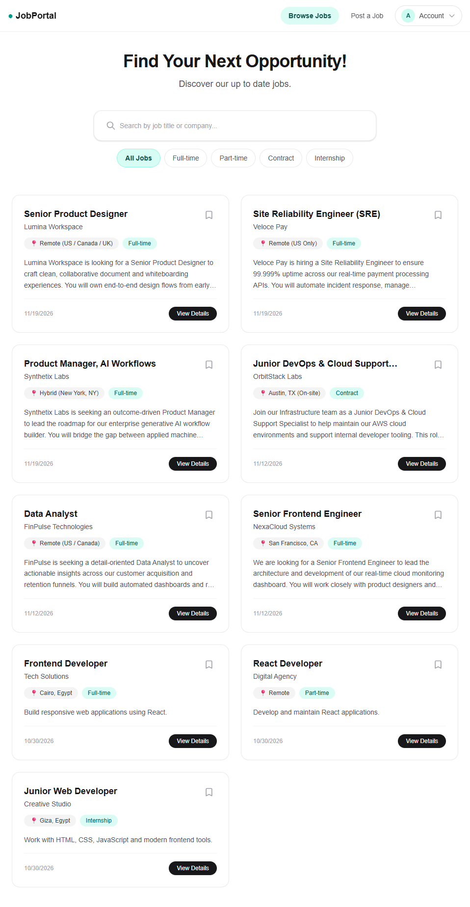
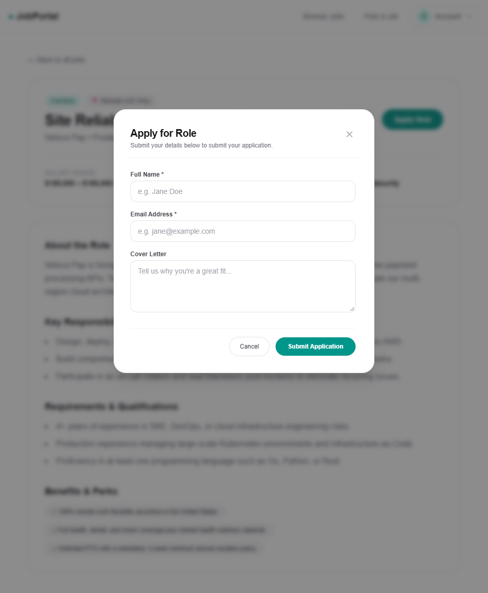
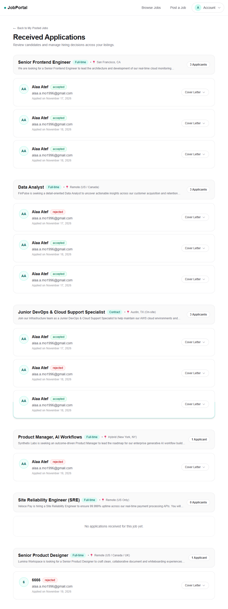
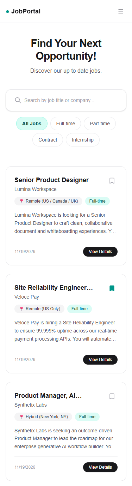

# JobPortal — React Job Board

A single-page job board where anyone can browse and search listings, and signed-in users can post jobs, save listings, apply with a cover letter, and (as employers) review and accept or reject applicants.

Built with **React 19**, **React Router (data router)**, **TanStack Query**, **Redux Toolkit**, **Tailwind CSS v4**, and **Firebase Authentication + Realtime Database** (accessed through their REST APIs).

> **Live demo:** _add link here once deployed_
> **Repository:** _add link here_

---

## Screenshots

| Browse jobs                                                        | Job details                                                         |
| ------------------------------------------------------------------ | ------------------------------------------------------------------- |
|  |  |

| Apply modal                                                         | Employer: received applications                                                         |
| ------------------------------------------------------------------- | --------------------------------------------------------------------------------------- |
|  |  |

| Mobile layout                                                           |
| ----------------------------------------------------------------------- |
|  |

---

## Features

**For everyone**

- Browse all job listings
- Search by job title or company, and filter by employment type (Full-time, Part-time, Contract, Internship)
- View a full job page: description, responsibilities, requirements, benefits, salary, experience level, department

**For signed-in users**

- Sign up and log in with email and password
- Save and unsave jobs, with a dedicated _Saved Jobs_ page
- Apply to a job with a full name, email, and cover letter (in an accessible native `<dialog>` modal)
- _My Applications_ page showing each application's status (pending / accepted / rejected); applications to jobs that were later removed are shown as "Position Unavailable"
- Protected routes: unauthenticated visitors are redirected to the login page, and logged-in users are redirected away from it
- Automatic logout when the session expires

**For employers (any signed-in user who posts jobs)**

- Post, edit, and delete job listings (including dynamic lists for responsibilities, requirements, and benefits)
- _My Posted Jobs_ page with applicant counts
- _Received Applications_ page grouped by job, with expandable cover letters, a "Reply via Email" link, and **Accept / Reject** actions

**General**

- Toast notifications for success and error feedback
- Loading, error (with retry), and empty states on the main pages
- Responsive layout with a collapsible mobile navigation

---

## Tech stack

| Area         | Tools                                                                                         |
| ------------ | --------------------------------------------------------------------------------------------- |
| UI           | React 19, Tailwind CSS v4                                                                     |
| Routing      | React Router v7 (`createBrowserRouter`, loaders for route guards, actions for the auth form)  |
| Server state | TanStack Query v5 (queries, mutations, cache invalidation)                                    |
| UI state     | Redux Toolkit (global notification/toast state)                                               |
| Backend      | Firebase Authentication (Identity Toolkit REST API) and Firebase Realtime Database (REST API) |
| Tooling      | Vite 8, ESLint 10 (`eslint-plugin-react-hooks`, `eslint-plugin-react-refresh`)                |

The Firebase JavaScript SDK is **not** used; the app talks to Firebase over `fetch`.

---

## Getting started

### Prerequisites

- Node.js **20.19+** or **22.12+** (required by Vite 8)
- A Firebase project (free Spark plan is enough)

### 1. Clone and install

```bash
git clone <your-repo-url>
cd <repo-folder>
npm install
```

### 2. Set up Firebase

1. Create a project in the [Firebase console](https://console.firebase.google.com/).
2. **Authentication → Sign-in method:** enable **Email/Password**.
3. **Realtime Database → Create database** and note its URL (it looks like `https://<project-id>-default-rtdb.<region>.firebasedatabase.app`).
4. **Project settings → General → Your apps → Web app:** copy the **Web API key**.
5. Apply the security rules described in [Firebase security rules](#firebase-security-rules) before sharing the app with anyone.

### 3. Configure environment variables

Copy `.env.example` to `.env` in the project root, then replace the placeholder values with your own Firebase configuration.

```env
VITE_FIREBASE_API_KEY=your-web-api-key
VITE_FIREBASE_DATABASE_URL=https://your-project-id-default-rtdb.your-region.firebasedatabase.app
```

Notes:

- Vite exposes `VITE_*` variables to the browser bundle. A Firebase web API key is an identifier, not a secret, so security depends on your **database rules**, not on hiding the key. It is still good practice to restrict the key (HTTP referrers + only the Identity Toolkit API) in Google Cloud Console.
- Do not commit `.env`. Keep it listed in `.gitignore`.

### 4. Run

```bash
npm run dev       # start the dev server
npm run build     # production build to dist/
npm run preview   # preview the production build
npm run lint      # run ESLint
```

> **Deploying:** the app uses `createBrowserRouter`, so your host must rewrite all paths to `index.html` (for example a `_redirects` file on Netlify or a rewrite rule on Vercel/Firebase Hosting). Otherwise refreshing on `/jobs/<id>` returns a 404.

---

## Project structure

```
src/
├── actions/       # Router actions (login / signup)
├── api/           # Firebase REST helpers (auth, jobs, applications), query client, token utils
├── components/    # Reusable UI (JobCard, JobForm, ApplicationForm, MainNav, ...)
│   └── UI/        # LoadingSpinner, ErrorBlock, NotificationToast
├── hooks/         # useSavedJobs, useDeleteJob
├── loaders/       # requireAuth route guard
├── pages/         # Route-level components
├── store/         # Redux store and notification slice
├── App.jsx        # Router configuration
└── main.jsx       # Entry point
```

---

## How it works

### Authentication

- Sign-up and login call the Firebase Identity Toolkit REST endpoints from a React Router **action**.
- On success, the ID token, user ID, email, and expiry time are stored in `localStorage`.
- A root route **loader** reads the token; protected routes use a `requireAuth` loader that redirects to `/auth` when the token is missing or expired.
- A timer in the root layout logs the user out when the token expires. Sessions last as long as the Firebase ID token (about one hour); there is no refresh-token flow yet.
- Database requests send the ID token as the `auth` query parameter.

### Data model (Realtime Database)

```
jobs/{jobId}                          title, company, location, type, salary, experienceLevel,
                                      department, description, responsibilities[], requirements[],
                                      benefits[], ownerId, createdAt
savedJobs/{userId}/{jobId}            true
applicationsByJob/{jobId}/{applicantId}    fullName, email, coverLetter, status, appliedAt
applicationsByUser/{applicantId}/{jobId}   same shape as above
```

Applications are stored in two places so employers can list applicants per job and applicants can list their own applications. Both copies are written (and status changes are applied) in a **single atomic multi-path update**, so they cannot drift apart.

### Application workflow

1. A signed-in user opens a job and clicks **Apply Now**; the app first checks whether they already applied and disables the button if so.
2. Submitting the modal writes the application with status `pending`.
3. The job owner opens **Received Applications**, reads the cover letter, and clicks **Accept** or **Reject**.
4. The applicant sees the updated status in **My Applications**.

### State management

- **Server state** (jobs, saved jobs, applications) lives in TanStack Query with per-user query keys; mutations invalidate the relevant queries.
- **UI state** that is not tied to the server (toast notifications) lives in Redux Toolkit.

---

## Firebase security rules

The app uses Firebase Realtime Database security rules to enforce:

- Job ownership on creation, updates, and deletion
- Applicants writing only their own applications
- Job owners accepting or rejecting applications
- Users accessing only their own saved jobs and applications

- Firebase Realtime Database rules enforce authorization independently of client-side checks.

See [`database.rules.json`](./database.rules.json) for the complete rules.

---

## Known limitations

- No automated tests.
- All jobs are downloaded and filtered/searched on the client; there is no pagination or server-side querying yet.
- Sessions end after about an hour (no token refresh).
- Deleting a job removes its related applications from both application records, but may leave orphaned saved-job entries.
- Authorization depends entirely on Firebase Realtime Database rules (the client-side ownership checks are for UX only).

---

## Author

**Alaa Atef** — Frontend Developer

[Portfolio](https://alaa-a-mo.github.io/portfolio/) / [LinkedIn](https://www.linkedin.com/in/alaa-atef96/) / [GitHub](https://github.com/alaa-a-mo)
